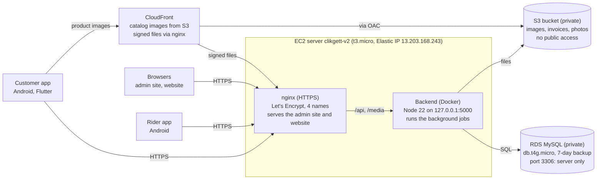

# ClikGett on AWS: what is running

11 Nov 2026

## Summary

Since 11 Nov 2026, ClikGett runs only the new build on AWS: one t3.micro server in Mumbai (ap-south-1) behind Elastic IP 13.203.168.243, a private MySQL database (RDS) and a private image bucket served through CloudFront. The apps, the admin site (admin.clikgett.com) and the website (clikgett.com) all point there. Account 288761749672.

- **Live:** api.clikgett.com, admin.clikgett.com, clikgett.com and www all answer over HTTPS. The new customer and rider APKs use `https://api.clikgett.com/api`.
- **Data:** the live database was kept (1,951 customers, 935 orders, 1,182 products) and upgraded to the new build's tables. 1,778 of 1,780 catalog images are in the bucket.
- **Security:** the database and the image bucket are no longer reachable from the internet. Before 11 Nov, anyone could download customer invoices, photo orders and rider documents from the bucket, and port 3306 was open to everyone.
- **Not yet removed:** the old server, the old test server, two rehearsal databases and three 2025 snapshots. They are stopped or unused but still billed until the clean-up script runs (Open items).

Rough monthly cost of what stays, at approximate on-demand list prices: about US$30 to 35 (server about $8, its disk about $2, database about $15 to 18, IP address about $4, CloudFront and S3 a few dollars at current traffic). Confirm in AWS Billing; the leftovers add roughly $30 to 35 more until deleted.

## Architecture

Only the server faces the internet; the database and image bucket stay private.

Apps and browsers reach one server over HTTPS; nginx serves the admin site and website and passes `/api` and `/media` to the backend container. Product images come from CloudFront, which reads catalog folders straight from the private bucket and sends signed private files (invoices, photo orders) through the backend, which checks the signature.

## Resource inventory

Everything in the account in Mumbai (ap-south-1) as of 11 Nov 2026; CloudFront is global. "Remove" rows go when the clean-up script runs.

| Resource | Type | ID / name | Size | Purpose | Status |
| --- | --- | --- | --- | --- | --- |
| Server | EC2 | `clikgett-v2` (i-0e49954297e2ba356) | t3.micro, 2 vCPU, 1 GB RAM + 2 GB swap, 20 GB gp3 encrypted | Docker backend, nginx, admin site, website | Keep |
| Server stack | CloudFormation | `clikgett-server` | - | Defines the server, its firewall and launch template | Keep |
| Public address | Elastic IP | 13.203.168.243 (eipalloc-062b76f58c94292c7) | - | DNS for api, admin, clikgett.com, www | Keep |
| Server firewall | Security group | `clikgett-web` (sg-0b662afd69b80dc58) | - | 80/443 open, 22 from office IPs only | Keep |
| Database | RDS MySQL 8.4.8 | `clikgett` (database `clikgett-dev`) | db.t4g.micro, 20 GB gp3 encrypted | All app data | Keep |
| Database firewall | Security group | `default` (sg-0192c19ecc8d950a9) | - | 3306 from `clikgett-web` and office IP 49.207.6.163 | Keep |
| Database snapshots | RDS manual | `before-v2-server-2026-11-11`, `before-release-2026-10-29` | 20 GB each | Restore points before the two releases | Keep |
| Daily backups | RDS automatic | 7 days | - | Point-in-time restore | Keep |
| Image bucket | S3 | `clikgett` | about 1,800 catalog images plus invoices, photo orders | Product, category and banner images; private files | Keep |
| Image delivery | CloudFront | E3DF3ZQG80KBMV (d3c9kvg5gaqz48.cloudfront.net) | Price class 200 | Catalog images from S3 (OAC); private files via backend | Keep |
| Bucket access | CloudFront OAC | `clikgett-s3-oac` (E1UXOOEAVR1WIP) | - | Lets only CloudFront read the bucket | Keep |
| Database public address | Elastic IP | 3.6.97.243 | - | Owned by RDS, not a spare IP | Keep (managed by RDS) |
| Old server disk copy | EBS snapshot | snap-0f634ba667b1cc0b4 (11 Nov), snap-0031ee98c087c780b (29 Oct) | 16 GB | Old server as it was | Keep for now |
| Old server | EC2 | `clikgett` (i-037b8d21955d5b369) | t3.micro, 16 GB | Old Node 18 backend | Stopped, remove |
| Old test server | EC2 | `cligget-test` (i-0203cd7a9a75819ca) | t2.micro, 16 GB | Unused since 2025 | Stopped, remove |
| Old test IP | Elastic IP | 13.201.216.230 | - | On the old test server | Remove (billed) |
| Old firewall | Security group | `launch-wizard-1` (sg-03682ad4556b93bca) | - | Old servers; opened 22, 81, 3000 to everyone | Remove |
| Rehearsal databases | RDS | `clikgett-rehearsal`, `clikgett-rehearsal2` | db.t4g.micro, 20 GB each | Practice copies for the release | Running, remove |
| 2025 snapshots | RDS manual | `clikgettdb`, `clikgettnew15th`, `my-unencrypted-copy` | 20 GB each | Copies from 15 May 2025 | Remove |
| Cache | ElastiCache | none | - | The backend only used Redis in a health check | Not created |

## Security

Only ports 80 and 443 on one server face the internet; the database, the bucket and the backend process do not.

| Area | Before 11 Nov | Now |
| --- | --- | --- |
| Server ports | 22, 80, 81, 443, 3000 open to everyone | 80 and 443 open; SSH (22) only from office IPs 106.215.169.5 and 49.207.6.163 |
| Backend process | Port 3000 reachable directly | Listens on 127.0.0.1 only; reached through nginx over HTTPS |
| Database | Public, 3306 open to everyone | Not public; 3306 only from the server's security group and one office IP |
| Image bucket | Every file public, including invoices, photo orders and rider documents | Fully private (public access blocked, object ACLs off); only CloudFront reads catalog folders |
| Private files | Plain public links | Signed links that expire after 60 minutes, checked by the backend |
| HTTPS | Let's Encrypt, renewed by a cron script | Let's Encrypt for 4 names, renewed by certbot's timer (renewal test passed); HSTS on |
| Server | Unencrypted disk, root PM2 process, no swap | Encrypted disk, IMDSv2 only, container runs as an unprivileged user, automatic security updates, log size limits |
| Backups | 1-day database backups, no disk snapshots | 7-day database backups plus manual snapshots before each release |
| Secrets | In the server's `.env` | Still in the server's `.env` (mode 600), copy outside git on the dev PC; never in the repo |

AWS access for the developer is the IAM user `VPD-dev` (PowerUser, MFA on); it cannot change IAM or billing.

## What changed on 11 Nov 2026

The switch took about two hours with the store closed; there were no active customers. Newest first, all IST.

| Time | Change |
| --- | --- |
| 10:35 | Server resized to t3.micro (client decision; t3.small after approval if needed) |
| 10:30 | Database made private; image links switched to CloudFront |
| 10:25 | Bucket made fully private; CloudFront reads it through OAC, private files go to the backend |
| 10:15 | Background jobs (payment sweep, housekeeping) switched on, on this server only |
| 10:11 | Elastic IP moved to the new server; old server stopped. Downtime on the switch: seconds |
| 10:09 | nginx, the 4 certificates, the admin build and the website installed on the new server |
| 10:00 | Live database upgraded: 121 table changes, migrations, OTP hardening, UTC order times (935 orders), store setup from the test admin (46 steps), image addresses converted (2,343 order items) |
| 09:45 | New server created from CloudFormation; backend built in Docker |
| 09:40 | Fresh backup of the old server: certificates, nginx, settings, website, old invoices |
| 09:36 | Snapshots: database `before-v2-server-2026-11-11`, old server disk snap-0f634ba667b1cc0b4 |
| 09:30 | Database firewall: 3306 closed to the internet |
| 09:20 | Bucket: invoices, photo orders and rider documents no longer public |

## Open items

The clean-up and the data fixes are prepared as one script that asks before each part: `deploy\aws-fixes\run-aws-cleanup-and-fixes.ps1` on the dev PC. The automated assistant was not allowed to run deletions or live data changes itself.

- [ ] **Run the clean-up script, parts 1 to 3:** terminate the old server and `cligget-test`, release IP 13.201.216.230, remove security group `launch-wizard-1`, delete both rehearsal databases and the three 2025 snapshots. Saves roughly $30 to 35 a month.
- [ ] **Run part 4, the live data fixes.** Two settings have 5 copies each (`FeedbackRewardAmount` is ₹20 in four rows and ₹25 in one); the script keeps ₹20 and adds the unique key. It hides 3 leftover automated test products (IDs 1214 to 1216) that customers can see. It drops a missing back photo from product 129. It turns off 3 empty duplicate accounts that share a mobile number with an active one.
- [ ] **Run part 5 and add the live Razorpay webhook:** URL `https://api.clikgett.com/api/payments/razorpay-webhook`, event `payment.captured`, the secret the script prints. Without it, payments the app fails to confirm are only recovered by the 10-minute sweep.
- [ ] **Rider push notifications:** the server needs the service-account key of the Firebase project `clikgett-delivery`. Download it from the Firebase console (Project settings, Service accounts) and give it to the developer. Customer pushes work.
- [ ] **Publish the new customer app** to the Play Store. The current Play version talks to the new backend; publishing needs the Play upload key (see report 19, item 3.1).
- [ ] **Re-upload the Surf Excel Matic 500 ml back photo** in admin (product 129).
- [ ] **12 more numbers have duplicate accounts,** but only one of each is active, so login works. Merge them only if the client wants to.
- [ ] **Delete the old server's disk snapshots** after a few stable weeks (snap-0f634ba667b1cc0b4, snap-0031ee98c087c780b). Keep the database snapshots.

## How to operate

The full runbook is `deploy/aws/README.md` in the repo (branch `dev/local-docker-updates`). The server's settings file is `/opt/clikgett/.env` on the server, with a copy at `deploy/aws.env` on the development PC; it is never in git.

| Task | How |
| --- | --- |
| Deploy a new backend version | Copy the `Backend` folder from the release commit to `/opt/clikgett`, then `sudo docker compose up -d --build`. Database migrations run on start; check `https://api.clikgett.com/api/health/db` afterwards |
| Change a setting | Edit `/opt/clikgett/.env`, then `sudo docker compose up -d --force-recreate` (a plain restart keeps the old settings) |
| Deploy the admin site | Build with `REACT_APP_BASE_URL=https://api.clikgett.com/api`, copy the build into `/var/www/admin` |
| Build the apps for this server | Customer: `--dart-define=API_BASE_URL=https://api.clikgett.com/api`. Rider: `-PapiBaseUrl=https://api.clikgett.com/api/` |
| Bigger server | Change `InstanceType` in CloudFormation stack `clikgett-server` (for example to t3.small). About 2 minutes of downtime; the IP and data stay |
| Restore the database | RDS keeps 7 days of automatic backups (restore to any point in time) plus manual snapshots, the latest `before-v2-server-2026-11-11` |
| SSH | `ssh -i clikgett_key.pem ubuntu@13.203.168.243`, only from the two office IPs. The key is the `clikgett` key pair (PuTTY file `clikgett.ppk`) |
