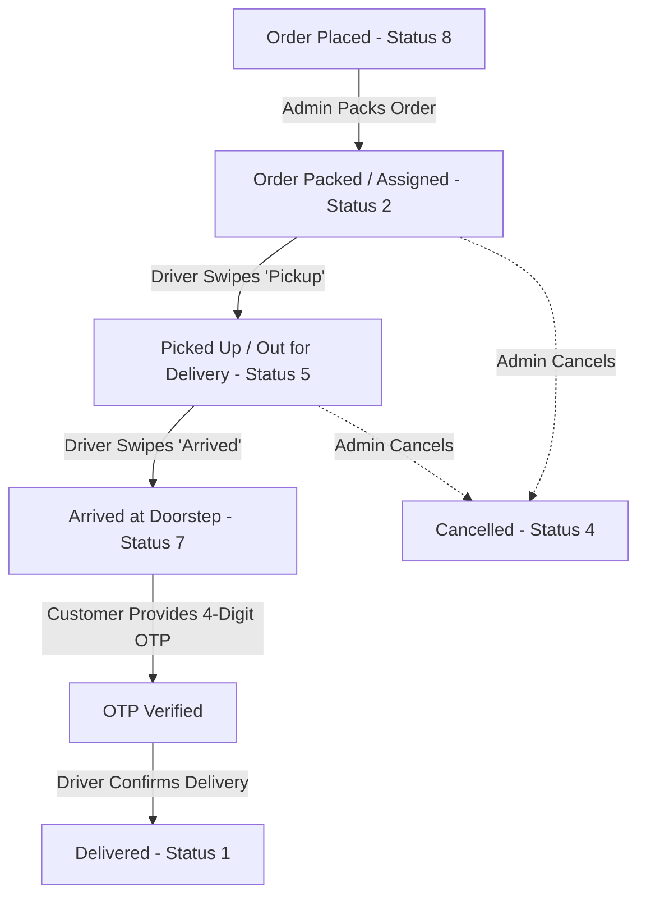
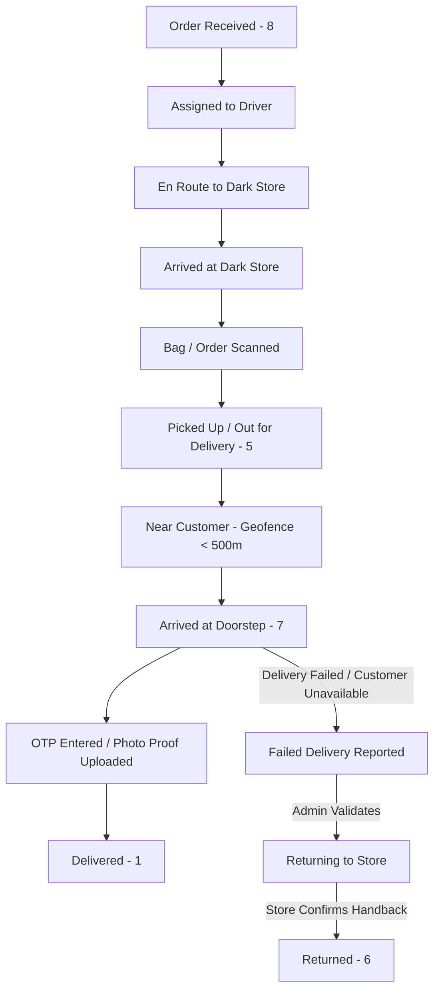
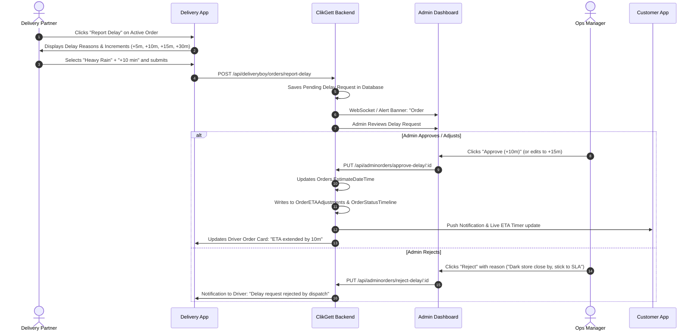
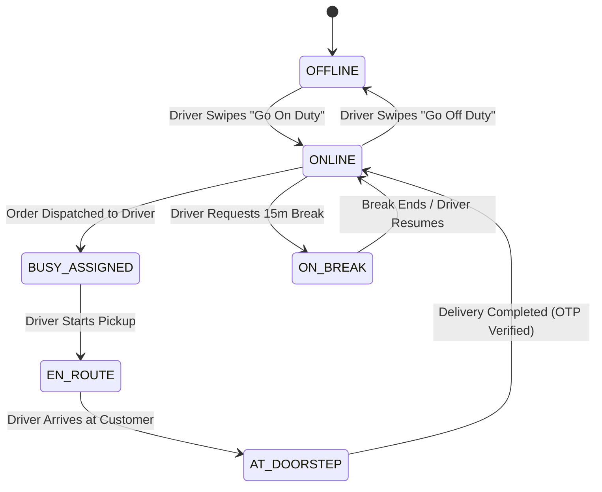

# ClikGett Delivery Dashboard — Operational & Architectural Gap Analysis

---

## 1. Live Delivery Location Audit

### Trace of Existing Location Capabilities
- **`GPSTracker.java`:** Exists under `Flutter/Deliveryboy/app/src/main/java/com/deliveryboy_clickget/GPSTracker.java`. It implements `android.location.LocationListener` and contains logic to query `LocationManager.NETWORK_PROVIDER` and `LocationManager.GPS_PROVIDER`.
- **Instantiation:** Searched the entire Android project for `new GPSTracker(` or `GPSTracker`. **Result: 0 occurrences outside its own class definition.** It is completely orphaned.
- **Manifest Permissions:** `AndroidManifest.xml` only requests storage and network state:
  ```xml
  <uses-permission android:name="android.permission.INTERNET" />
  <uses-permission android:name="android.permission.ACCESS_NETWORK_STATE" />
  <uses-permission android:name="android.permission.ACCESS_WIFI_STATE" />
  ```
  `ACCESS_FINE_LOCATION`, `ACCESS_COARSE_LOCATION`, and `ACCESS_BACKGROUND_LOCATION` are **absent**.
- **Backend Transmission:** There is **no API endpoint** in `Backend/server/routes/DeliveryBoy.js` or any other route accepting coordinates from delivery boys.
- **Backend Storage:** Neither `AdminUsers` nor `Orders` contains a column for driver live coordinates. Only `Orders.Latitude` and `Orders.Longitude` exist, which store the customer delivery address coordinates.
- **User / Admin Visibility:** Because no driver location is received or stored, neither the Admin Dashboard nor the User App can display live rider location on a map.

### Summary Checklist of Specific Inquiries
| Question | Audit Finding |
|---|---|
| Is driver location sent to backend? | **NO.** No API call exists in Android app or backend. |
| How frequently? | **N/A (0 Hz).** No polling or transmission mechanism. |
| Where is it stored? | **Nowhere.** Database schema has no driver coordinates column. |
| Can Admin retrieve it? | **NO.** Admin displays only static driver name and customer address. |
| Can User retrieve it? | **NO.** User App shows static status steps; no live rider marker. |
| Is location linked to OrderID or DeliveryBoyID? | **Neither.** |
| Is there historical location breadcrumb tracking? | **NO.** |
| What happens when app is minimized? | No foreground service exists; OS suspends background execution. |
| What happens when GPS is disabled? | App does not check GPS provider availability. |
| Rapid driver location changes handled? | No interpolation, dead reckoning, or Kalman filtering present. |

---

## 2. Navigation Capabilities Audit

### In-App vs External Navigation
- **`NavigationActivity.java`:** Contains 20 lines of stub code:
  ```java
  public class NavigationActivity extends AppCompatActivity {
      String MobileNo, Latitude, Longitude;
      @Override
      protected void onCreate(Bundle savedInstanceState) {
          super.onCreate(savedInstanceState);
          setContentView(R.layout.activity_navigation);
          getSupportActionBar().hide();
          MobileNo = getIntent().getStringExtra("MobileNo");
          Latitude = getIntent().getStringExtra("Latitude");
          Longitude = getIntent().getStringExtra("Longitude");
      }
  }
  ```
  `activity_navigation.xml` contains a raw `<fragment android:id="@+id/map" />` lacking a provider class. This Activity is **never started from anywhere in the app**.
- **Actual Navigation Trigger:** Located in `OrderDetailsActivity.java` (lines 1633–1646):
  ```java
  viewmap_txt.setOnClickListener(new View.OnClickListener() {
      @Override
      public void onClick(View view) {
          try {
              Uri uri = Uri.parse("google.navigation:q=" + jsonObject.getString("Latitude") + "," + jsonObject.getString("Longitude") + "&mode=d");
              Intent intent = new Intent(Intent.ACTION_VIEW, uri);
              intent.setPackage("com.google.android.apps.maps");
              startActivity(intent);
          } catch (JSONException e) {
              e.printStackTrace();
          }
      }
  });
  ```
- **Operational Reality:**
  - In-app navigation is a **non-functional placeholder**.
  - Navigation operates strictly via an **external Intent** launching the standalone Google Maps application.
  - While external navigation is reliable for routing, it forces the delivery partner to leave the ClikGett app, breaking task continuity and losing context for customer calls, delay reporting, or OTP entry.

---

## 3. Delivery Status Flow

### Current Status Flow
In the current ClikGett implementation, the delivery lifecycle relies on numerical codes stored in `Orders.OrderStatus`:



### Limitations of Current Lifecycle
1. **No "Going to Store" / "At Store" Stage:** If orders originate from a central dark store or restaurant, the system cannot distinguish between a rider en route to the store and a rider waiting for the order to be packed.
2. **Missing Proximity Checks:** The transition from Status 5 (`Picked Up`) to Status 7 (`Arrived`) can be triggered by the driver anywhere, regardless of physical proximity to the customer.
3. **No Failed Delivery / Return State:** If the customer is unreachable, the address is invalid, or the customer refuses payment, the driver has no flow to initiate a return to the warehouse.

### Recommended Quick-Commerce Status Flow


---

## 4. Delay Management Audit & Recommendation

### Existing Delay Handling
- **Driver Side:** **Zero capability.** The driver has no UI button or API endpoint to report a delay.
- **Admin Side:** Admin has an editable delivery time feature in `OrderDetails.jsx`:
  - Calls `PUT /api/adminorders/editedeliverytime/:OrderID`
  - Adjusts `Orders.EstimateDateTime` by +5, +10, +15, or custom minutes.
  - Inserts record into `OrderETAAdjustments` audit table.
  - Inserts note into `OrderStatusTimeline`.
- **Gap:** The driver experiencing the delay in the field cannot communicate the delay into this system. Admin only finds out through offline telephone calls.

### Recommended Operational Delay Flow (Analysis Only — Do Not Implement)


### Safe Operational Rule:
Driver-submitted delays must **not** automatically extend the customer SLA without Admin review unless predefined operational conditions are met (e.g., active torrential rainfall detected within store geofence, or store-wide traffic surge declared). Human-in-the-loop approval prevents driver gaming while ensuring transparent customer communication.

---

## 5. Weather & Rain Intelligence Audit

### Current System Status
- **Precipitation Detection:** None. No OpenWeather, AccuWeather, or IMD API integrated.
- **Rain Surcharge / Delivery Buffers:** In `AdminShopToggleSettings`, settings exist for base delivery charge, price per km, and long distance fees (`LongDistanceFeeEnabled`, `LongDistanceThresholdKm`), but **zero settings exist for surge/weather pricing or bad-weather buffers**.
- **Driver Visibility:** Driver app has no weather alert or safety warnings.
- **Admin Visibility:** Admin has no weather overview.

### Recommended Integration Model:
1. **Context-First (Safest Operational Model):** Weather APIs should poll dark store locations every 15 minutes. If rainfall > 5mm/hr is detected:
   - Admin receives an automated alert: *"Heavy Rain detected near Store A."*
   - Admin can activate a 1-click **"Rain Mode"** for Store A.
   - Rain Mode automatically adds a default +10 min buffer to all incoming orders from that store and displays a weather badge in the User App: *"Deliveries may take slightly longer due to heavy rain."*
2. **Safety Warnings:** When Rain Mode is active, the Delivery App displays a driver safety reminder on the home screen: *"Drive safely. Slippery roads reported in your zone."*

---

## 6. Admin Live Delivery Operations Dashboard

### Current Admin Screen
- Orders are viewed as standard tables in `Orders.jsx` (Current Orders / Past Orders).
- Columns: Order ID, Customer Name, Mobile, Amount, Status, Delivery Boy Name.
- Live operations features: **Missing.**

### Recommended Live Operations Dashboard Architecture
```
ADMIN OPERATIONS DASHBOARD
┌─────────────────────────────────────────────────────────────────────────────────────────┐
│ [KPI BAR]                                                                               │
│ Active Deliveries: 24 | On-Time: 21 | Delayed (>5m): 3 | Drivers Online: 14 | Idle: 4   │
├─────────────────────────────────────────────────────────────────────────────────────────┤
│ [SPLIT VIEW]                                                                            │
│ ┌─────────────────────────────────────────┐ ┌─────────────────────────────────────────┐ │
│ │ LIVE FLEET MAP                          │ │ LIVE DISPATCH QUEUE                     │ │
│ │                                         │ │                                         │ │
│ │  📍 Dark Store A (Origin)               │ │ Order # | Driver | Status | SLA | Delay │ │
│ │                                         │ │ ─────────────────────────────────────── │ │
│ │  🛵 Driver 1 (ETA: 4m - On Track)       │ │ #1021   | Ramesh | Out    | 04m | None  │ │
│ │  🛵 Driver 2 (ETA: 12m - Delayed ⚠️)     │ │ #1022   | Suresh | Out    | 12m | +8m ⚠️│ │
│ │  🏠 Customer Destination B              │ │ #1023   | Naresh | At Door| 01m | None  │ │
│ │                                         │ │                                         │ │
│ └─────────────────────────────────────────┘ └─────────────────────────────────────────┘ │
└─────────────────────────────────────────────────────────────────────────────────────────┘
```

---

## 7. Driver Availability & Shift State

### Current Driver Status
- Stored in `AdminUsers` table with `Role = 2`.
- Field `Status`:
  - `0`: Deleted
  - `1`: Active
  - `2`: Deactivated
- **Operational Reality:** This is an account management flag, not an operational shift state.

### Recommended Driver Duty Model


---

## 8. Issue & Incident Reporting

### Existing Capability
Drivers currently have no method to report field obstacles within the application. If a vehicle breaks down or a customer cannot be found, the driver must resolve it externally via phone calls.

### Recommended Incident Architecture
A distinct **"Report Incident"** module accessible from `OrderDetailsActivity.java`:
- **Categories:**
  1. *Vehicle / Bike Breakdown*
  2. *Accident / Medical Emergency*
  3. *Customer Unreachable / Phone Switched Off*
  4. *Customer Refusing Order / Wrong Address*
  5. *Damaged / Leaked Item During Transit*
  6. *Severe Weather / Flooded Road*
- **Actions Triggered:**
  - Emergency notifications: Immediate priority push to Admin Ops Dashboard.
  - Driver safety check: Prompt to call emergency dispatch or roadside assistance.
  - Reassignment workflow: Allows Admin to unassign order from Driver A and reassign to Driver B with 1 click.

---

## 9. Failure Scenarios Analysis

| # | Scenario | Current System Behavior | Operational Risk | Recommended Behavior |
|---|---|---|---|---|
| 1 | GPS Disabled on Driver Phone | App continues silently; no coordinates available. | Zero tracking; lost accountability. | Show blocking modal: *"GPS Required for Delivery Navigation"* with 1-tap shortcut to Android Location Settings. |
| 2 | Internet Disconnected / Offline | Retrofit/Volley throws `SocketTimeoutException` / `NoNetwork`. Screen freezes or shows Toast. | Driver cannot complete delivery or obtain OTP. | Local SQLite queue stores status updates and timestamps offline; syncs automatically upon reconnect. |
| 3 | Driver Force-Closes App | App process terminates. No background location running. | Order appears in limbo; customer has no visibility. | Android Foreground Service with ongoing notification keeps tracking alive; auto-restarts on boot. |
| 4 | Driver Reports Delay Twice | Feature does not exist. | N/A | Rate-limit delay submissions to once every 10 minutes unless approved by Admin. |
| 5 | Admin Changes ETA Twice | Handled cleanly: updates `EstimateDateTime`, appends multiple rows to `OrderETAAdjustments`. | Driver app does not update in real-time; customer sees timer jump. | Emit Socket.io `order:eta_updated` event to refresh both Driver and Customer screens simultaneously. |
| 6 | Customer Changes Address Mid-Delivery | Customer must call support; address in `Orders.Address` is static. | Driver arrives at old address; wasted fuel and SLA breach. | Customer address locked once status >= 5 (`Picked Up`). If changed via Admin, push route recalculation to Driver app. |
| 7 | Driver Rejects / Cancels Assigned Order | Driver has no cancel button. Only Admin can reassign. | If driver refuses delivery, order sits pending until customer complains. | Add "Reject Assignment" button within 60s of dispatch with mandatory reason code, returning order to unassigned pool. |
| 8 | App Crashes During Delivery | On relaunch, driver opens `MainActivity` -> `Pending Orders` -> re-enters `OrderDetailsActivity`. State is intact from server. | Disorienting UX; loss of navigation progress. | Save active order ID in `SharedPreferences`; auto-restore active order screen immediately on cold launch if order in transit. |

---

## 10. Quick-Commerce Operational Comparison

| Capability | ClikGett Current State | Quick-Commerce Benchmark (Blinkit / Zepto) | Gap Severity |
|---|---|---|---|
| **Delivery SLA Target** | Next day default (legacy timestamp); manual Admin +15m buttons | 10 to 15 minutes dynamic SLA timer | **CRITICAL (P0)** |
| **Driver Location** | None; GPS permissions missing in manifest | Continuous live GPS tracking (1 Hz on delivery, 0.1 Hz idle) | **CRITICAL (P0)** |
| **Driver Shift State** | Static account active/inactive | Real-time Online / Offline / On Duty / Break toggle | **CRITICAL (P0)** |
| **Order Notification** | Polled list; no FCM handler in Java | Loud audible siren alert + full-screen order dispatch modal | **CRITICAL (P0)** |
| **Navigation** | Launches external Google Maps app | In-app map navigation with turn-by-turn guidance and customer pin | **HIGH (P1)** |
| **Delay Management** | Admin manual ETA edit only; driver cannot report | Driver in-app delay reporting with structured reason tags | **CRITICAL (P0)** |
| **Proof of Delivery** | 4-digit customer OTP verification | Dual: OTP verification + Photo Proof of Delivery / Geotagged drop | **MEDIUM (P2)** |
| **Admin Operations** | Static table of orders and delivery boy dropdown | Live map with heatmaps, unassigned alerts, delayed SLA badges | **CRITICAL (P0)** |
| **Incident Reporting** | None; driver calls store manager | In-app incident logging (breakdown, accident, wrong address) | **HIGH (P1)** |
| **Driver Earnings** | Sum of customer order GMV | Transparent driver payout (Base pay + Distance pay + Surge + Tips) | **HIGH (P1)** |
